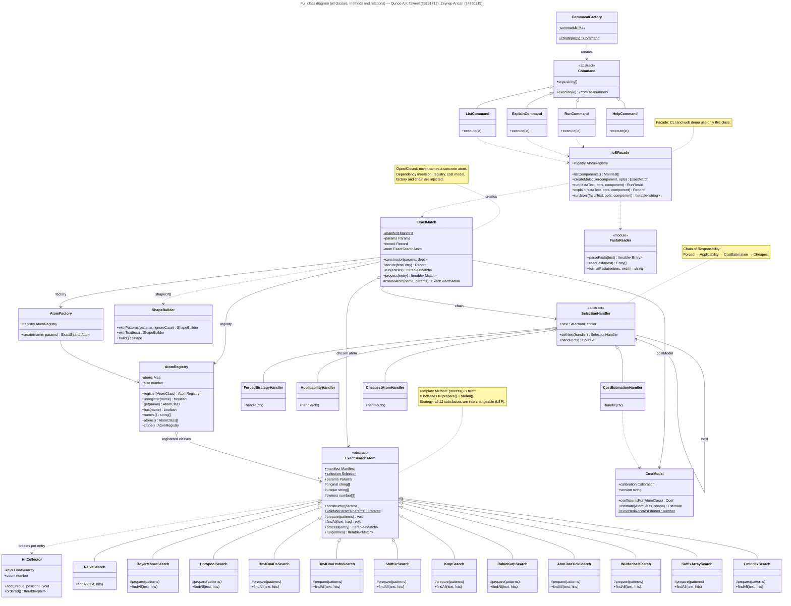
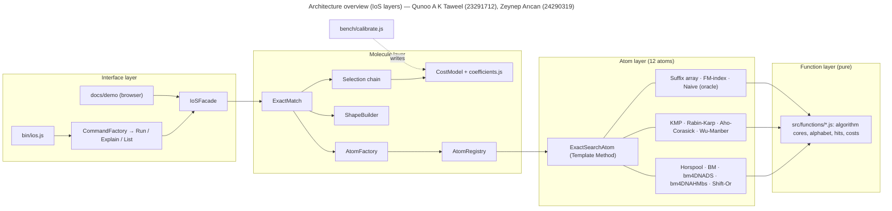
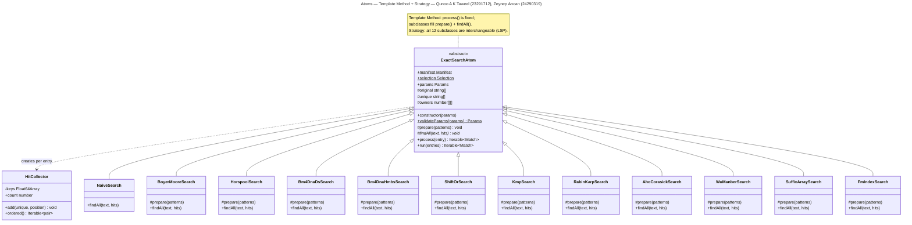
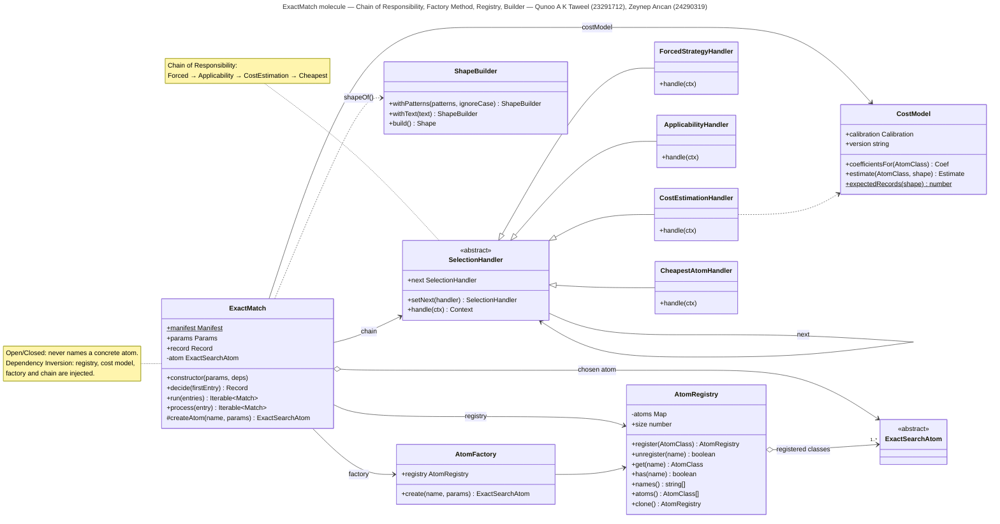
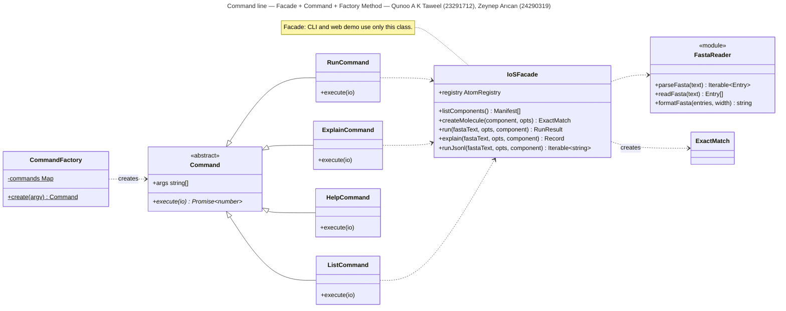
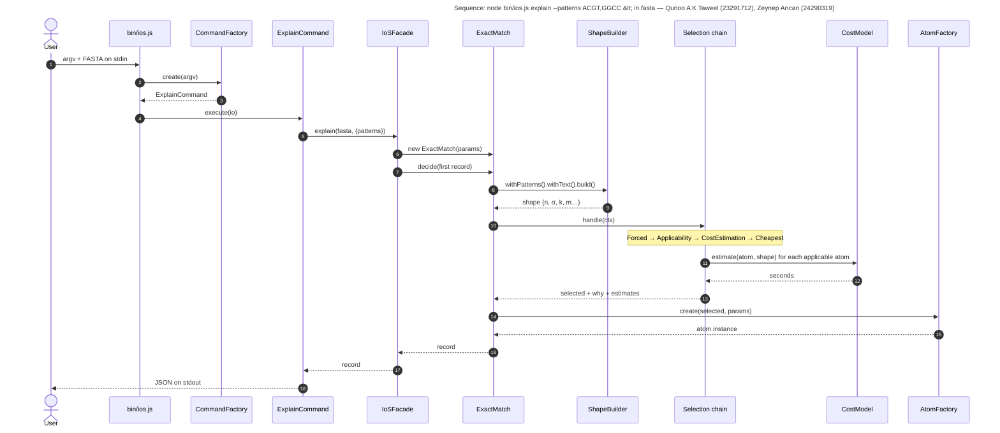
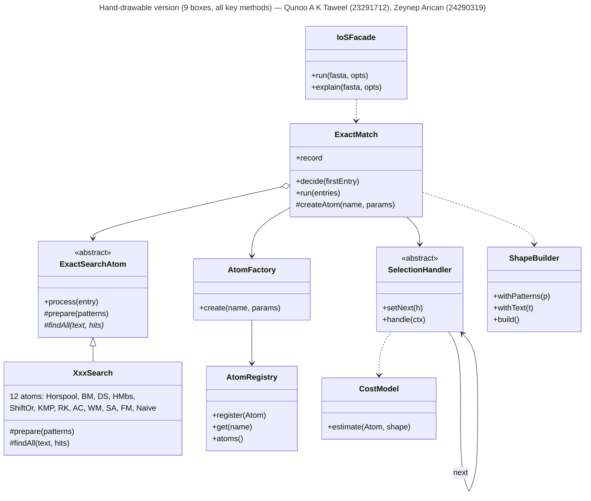

# UML diagrams

Rendered images (`.png`, `.svg`) are generated from the Mermaid sources (`.mmd`) with `node scripts/render-uml.mjs <mermaid.min.js>`. The same full class diagram is also available as PlantUML: [`class-diagram.puml`](class-diagram.puml). For drawing by hand, see [`hand-drawable.md`](hand-drawable.md).

| Diagram | Image | Source |
|---|---|---|
| Full class diagram | [png](00-full.png) · [svg](00-full.svg) | [00-full.mmd](00-full.mmd) |
| Architecture overview | [png](01-overview.png) · [svg](01-overview.svg) | [01-overview.mmd](01-overview.mmd) |
| Atoms (Template Method + Strategy) | [png](02-atoms.png) · [svg](02-atoms.svg) | [02-atoms.mmd](02-atoms.mmd) |
| Molecule and selection (Chain of Responsibility, Factory Method, Registry, Builder) | [png](03-molecule.png) · [svg](03-molecule.svg) | [03-molecule.mmd](03-molecule.mmd) |
| CLI (Facade + Command) | [png](04-cli.png) · [svg](04-cli.svg) | [04-cli.mmd](04-cli.mmd) |
| Sequence diagram: explain | [png](05-sequence-explain.png) · [svg](05-sequence-explain.svg) | [05-sequence-explain.mmd](05-sequence-explain.mmd) |
| Hand-drawable version | [png](06-hand-drawable.png) · [svg](06-hand-drawable.svg) | [06-hand-drawable.mmd](06-hand-drawable.mmd) |

GitHub renders the Mermaid sources directly:

## Full class diagram

## Architecture overview

## Atoms (Template Method + Strategy)

## Molecule and selection (Chain of Responsibility, Factory Method, Registry, Builder)

## CLI (Facade + Command)

## Sequence diagram: explain

## Hand-drawable version

